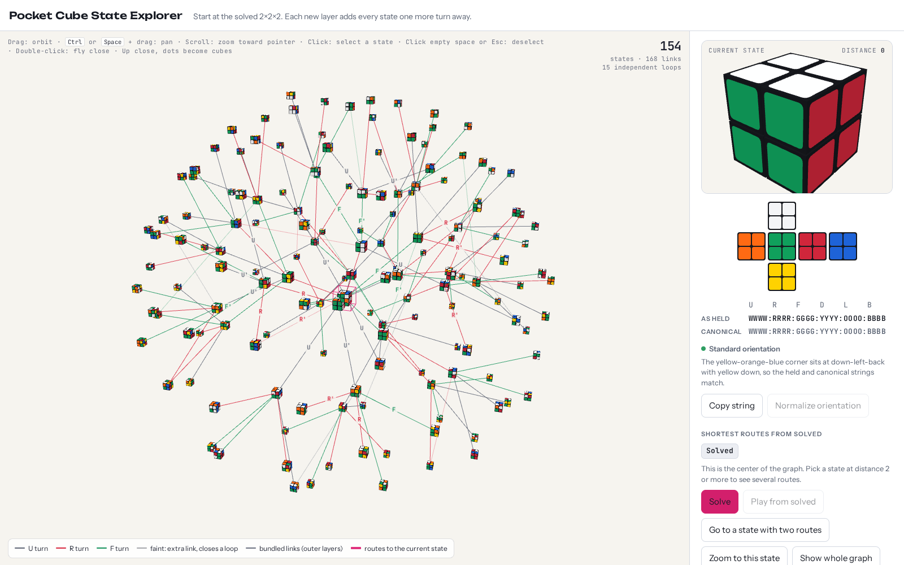
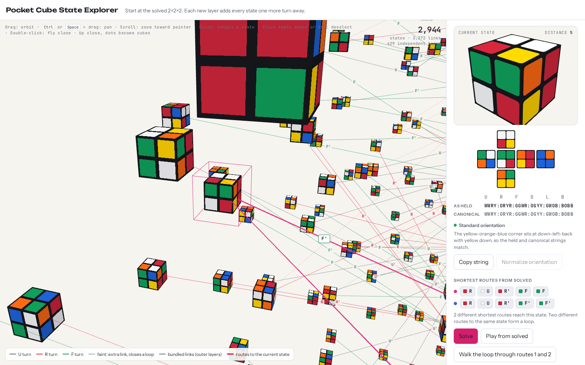
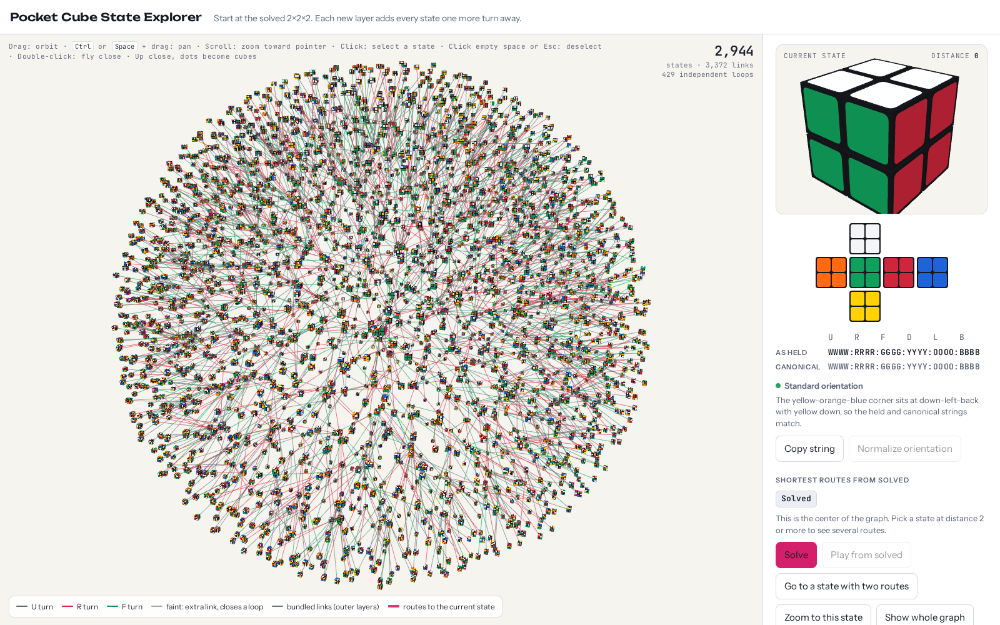
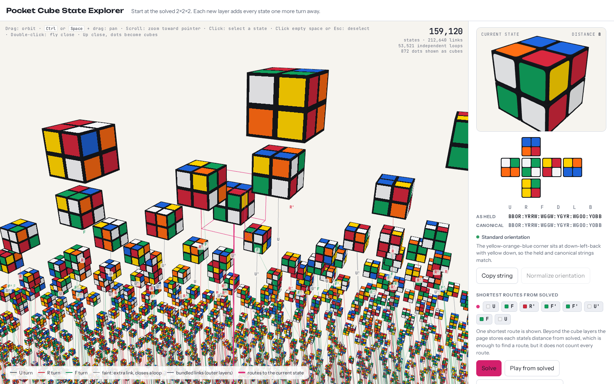
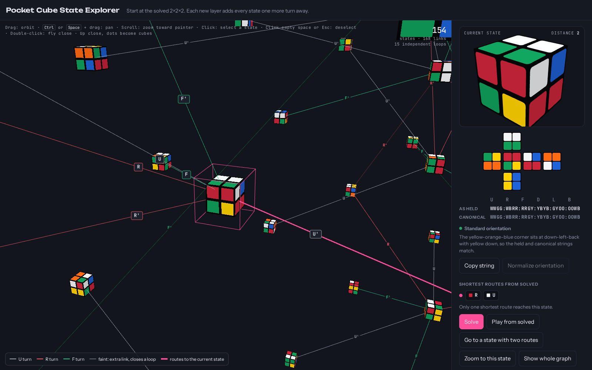

# Pocket Cube State Explorer

[](https://github.com/rafacm/pocket-cube-state-explorer/actions/workflows/ci.yml)

An interactive 3D map of every state of the 2×2×2 Rubik's Cube (the Pocket Cube). Start from the solved
cube in the centre and grow the graph layer by layer: each new layer holds every state one more turn
away, until all **3,674,160** states are drawn. Up close, the states are real cubes with their actual
stickers, and a large animated cube walks you along any route through the graph.

**Try it: [pocket-cube-state-explorer.vercel.app](https://pocket-cube-state-explorer.vercel.app)**
(a desktop browser with WebGL works best).



## What you can do

- **Grow the graph** one layer at a time, or let Auto-grow build all 14 layers (11 with half turns).
  The first 7 layers are drawn as stickered cubes with all their links; the outer layers stream in as
  dots with a live count and time estimate.
- **Select a state** by clicking it: the large cube jumps there and its shortest routes light up.
  **Solve** walks it back to solved, **Play from solved** builds it up, and the camera can follow the
  cube through the graph one state per turn. Click the selected cube again for boxed labels of the
  turns you can make from it; click one to make that turn.
- **Find a state** from a scramble (`R U R' F2`) or a facelet string (`WGWG:RRRR:GYGY:YBYB:OOOO:WBWB`),
  or jump to a random one. States beyond the drawn layers are found too, with their distance and a
  shortest route.



- **See that it is a graph, not a tree**: switch between all links, the tree of first routes, and the
  extra links that close loops; colour the outer dots by how many shortest routes enter each state;
  bundled links show where routes merge between the outer layers.



- **Zoom into any region** (scroll toward the pointer; pan with Space, ⌘ or Ctrl + drag; double-click to
  fly close): nearby dots turn into cubes with their links and turn labels.



- **Turn the cube** with U, R, F, D, L, B and whole-cube rotations x, y, z; the 2D net and facelet
  strings show the state, held and in canonical orientation.
- **Light or dark**: it follows your system, or pick one under Appearance; the 3D stage, links and
  labels change with it.



## Put it on your site

The explorer is also a web component. Add one script and the element:

```html
<script type="module" src="https://pocket-cube-state-explorer.vercel.app/embed/pocket-cube-explorer.js"></script>

<pocket-cube-explorer no-header></pocket-cube-explorer>
```

It renders inside its own shadow root, so your page's styles do not change it and its styles do not
leak into your page. It starts when it first scrolls near the viewport, and stops (freeing its WebGL
contexts) when it is removed from the page. A [demo page](https://pocket-cube-state-explorer.vercel.app/embed-demo.html)
shows two of them in a blog-like layout.

- `no-header` hides its title bar (your page has its own); `eager` starts it at once.
- Height: `--explorer-height` (default `720px`), e.g. `style="--explorer-height: 80vh"`. Narrower than
  860 px, the panel goes below the 3D stage and the element grows to fit.
- `data-theme="light"` or `"dark"` fixes its colour theme, 3D stage included (default: the system's);
  change the attribute and it recolours at once. The design tokens are CSS custom properties on its
  root, set per theme in `src/styles/tokens.css`.
- Keys (Esc to deselect, Space to pan) only act inside the explorer, never on the rest of your page.

Without a script, an iframe works too:

```html
<iframe src="https://pocket-cube-state-explorer.vercel.app/" title="Pocket Cube State Explorer"
        style="width: 100%; height: 720px; border: 0"></iframe>
```

## How it works

- **Model.** A state is the 24 sticker colours. Whole-cube rotations do not make new states, so every
  state is normalised to one canonical orientation (the yellow-orange-blue corner at down-left-back,
  yellow down) and the graph grows with U, R and F turns only, which never move that corner.
- **Counting every state once.** Each canonical state gets a unique number from 0 to 3,674,159 built
  from where its 7 movable corners are (7! = 5,040) and how 6 of them are twisted (3⁶ = 729; the 7th is
  forced). Move tables on those numbers let a breadth-first search visit all states in under a second,
  with one byte per state for its distance from solved. The layer sizes match the published counts
  (quarter turns: 1, 6, 27, 120, 534, 2,256, 8,969, 33,058, 114,149, 360,508, 930,588, 1,350,852,
  782,536, 90,280, 276).
- **Layout.** Each layer lives on its own sphere. The cube layers use a small force-directed layout;
  each dot layer is cut into patches on a cube map and its states are laid out inside the patch they
  want (next to the state they were reached from), then relaxed so that no two cubes overlap. The first
  dot layer is evened out once, so the spheres grow steadily from the centre.
- **Performance.** Instanced meshes with a custom shader draw tens of thousands of stickered cubes in one
  call; the outer layers are GPU point clouds; a grid index finds the dots near the camera; and the page
  only redraws when something changes.

## Development

Needs [Bun](https://bun.sh) (package manager, test runner and script runner).

```sh
bun install
bun run dev          # http://localhost:5173 with hot reload
bun run build        # dist/: the site, plus dist/embed/pocket-cube-explorer.js
bun run typecheck    # TypeScript, strict
bun run test         # unit tests: the cube model, the graph, distances of all 3,674,160 states
bun run e2e          # end-to-end tests in headless Chromium (Playwright)
bun run screenshots  # regenerates docs/screenshots/ and public/og.jpg (the link-preview image)
```

The end-to-end tests and screenshots need Playwright's Chromium (`bunx playwright install --with-deps
chromium`). They render with software WebGL, so no GPU is needed, but large dot layers take a while.
On a minimal Linux without root, `scripts/headless-deps.sh` unpacks Chromium's libraries and fonts
into `.cache/headless/` instead of installing them. CI runs the type check, unit tests, build and
end-to-end tests on every push and pull request; Vercel deploys `main`.

The code is in `src/`: `model/` (pure cube logic), `graph/` (the cube layers, routes, layout),
`outer/` (the dot layers), `render/` (Three.js scenes, labels, picking, camera), `cube/` (the live cube
and its walks), `ui/` (the panel) and `explorer/` (state and the frame loop). `CLAUDE.md` has a
detailed map.

## Technologies

- [TypeScript](https://www.typescriptlang.org/) (strict) and [Vite](https://vite.dev/), no UI framework
- [Three.js](https://threejs.org/) r147 (WebGL): `InstancedMesh` with a custom GLSL `ShaderMaterial`
  for the stickered cubes, `Points` for the outer layers, `LineSegments` for links, `OrbitControls`
  for the camera
- Typed arrays (`Uint8Array`, `Int32Array`, `Float32Array`) for the 3.6 million states
- Custom elements and shadow DOM for embedding; CSS custom properties and container queries
- Browser APIs: Canvas 2D, `ResizeObserver`, `IntersectionObserver`, `requestAnimationFrame`, Clipboard API
- Google Fonts: Unbounded, Instrument Sans, JetBrains Mono
- [Bun](https://bun.sh) tests, [Playwright](https://playwright.dev/) end-to-end tests and screenshots,
  GitHub Actions, [Vercel](https://vercel.com/)

## Related work

**The numbers**

- [Jaap's Puzzle Page: Pocket Cube](https://jaapsch.net/puzzles/cube2.htm) — the state count and the
  distance tables for both quarter-turn and face-turn metrics
- [God's Algorithm for the 2x2x2 Pocket Cube](https://www.math.rwth-aachen.de/~Martin.Schoenert/Cube-Lovers/Jerry_Bryan__God's_Algorithm_for_the_2x2x2_Pocket_Cube.html)
  (Jerry Bryan, Cube-Lovers mailing list, 1993) — the distance distribution, computed by exhaustive search
- [The pocket cube: correction, calculation, and conjectures](https://www.math.rwth-aachen.de/~Martin.Schoenert/Cube-Lovers/Dan_Hoey__The_pocket_cube__correction,_calculation,_and_conjectures.html)
  (Dan Hoey, Cube-Lovers mailing list, 1984) — early calculations of the Pocket Cube's positions

**Visualisations and tools**

- [sCUBEdiver: a visual analytics tool for discovering optimal 2x2x2 Rubik's Cube solution sequences](https://dataroom.liris.cnrs.fr/vizvid/trajectoires/rubix/s12650-026-01111-x.pdf)
  (Bence Dániel Erős and Roland Kunkli, *Journal of Visualization*, 2026) — compares solution paths of
  beginner, intermediate and optimal methods through the 2x2x2 state space, projected to 2D, with an
  animated 3D cube
- [Solving Small Rubik's Cubes as Slowly as Possible](https://drops.dagstuhl.de/storage/00lipics/lipics-vol366-fun2026/LIPIcs.FUN.2026.38/LIPIcs.FUN.2026.38.pdf)
  (Jenny Quan, Noah Kim, Bernardo Subercaseaux and John Mackey, FUN 2026) — studies the 2x2x2 graph of
  states and draws small parts of it; the full graph is too large for their figures
- [Rubik's TSNE](https://koaning.io/posts/rubik-tsne) (Vincent Warmerdam) — static maps of random cube
  states placed by similarity
- [Building an optimal Pocket Cube (2x2x2) Solver using Rust/WASM and Three.js/React](https://eddmann.com/posts/building-an-optimal-pocket-cube-solver-using-rust-wasm-threejs-and-react/)
  (Edd Mann) — finds and animates the shortest solution for any 2x2x2 state
- [Visualization of Rubik's Cube Solution Algorithms](https://research.jku.at/en/activities/visualization-of-rubiks-cube-solution-algorithms/)
  (Johannes Kepler University Linz) — a research talk on visualising how solution methods work

## License

[MIT](LICENSE) © 2026 Rafael Cordones.
